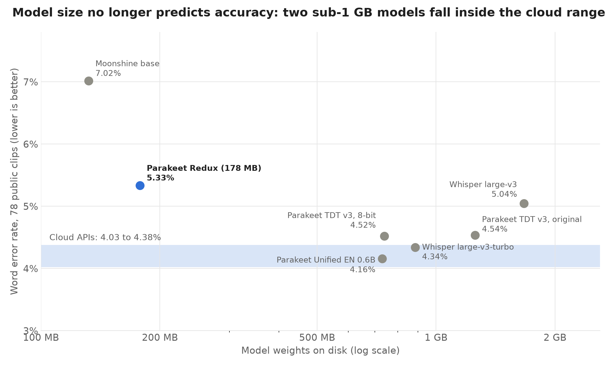

# Parakeet Redux speech-to-text benchmark

How much does a 178 MB ternary speech model give up against full-size local models and cloud APIs? I measured accuracy, speed, resource use, cost and privacy for 10 speech-to-text systems on one mid-range laptop, then reran the open models on a Kaggle T4 GPU.



## What I found

- Parakeet Redux is 7x smaller than the Parakeet TDT 0.6B v3 it comes from and about 2x faster on a laptop CPU (15x real time on a Ryzen 5 5600H).
- It costs about 0.8 WER points on average (5.33% vs 4.54%). The gap is small on clean benchmark audio and grows to 1.5 to 2.2 points on accented speech.
- Two sub-1 GB open models (Parakeet Unified EN 0.6B at 4.16%, Whisper large-v3-turbo at 4.34%) land inside the cloud range of 4.03 to 4.38%.
- On the T4, Redux ran at 85x real time against 74x for the original in NeMo, at 5.32% vs 4.72% WER. The paired difference is +0.60 points with a 95% interval of -0.25 to +1.26, so this sample can't separate them.
- Redux could not run natively on Windows (its Windows kernels lack the AVX2 path), so it ran in a Linux container on the same CPU. Runtime packaging mattered as much as the weights.

## Reports

| File | What it covers |
|---|---|
| [docs/report_laptop.md](docs/report_laptop.md) | Main write-up: 10 systems on a Ryzen 5 5600H + GTX 1650, including OpenAI, ElevenLabs and Gemini |
| [docs/report_kaggle.md](docs/report_kaggle.md) | Redux-focused rerun on a Tesla T4 and Xeon CPU, with paired comparisons and provenance |
| [docs/PROTOCOL.md](docs/PROTOCOL.md) | The method, written down before any runs |
| [docs/LOG.md](docs/LOG.md) | Lab notebook: every decision, failure and deviation, timestamped |
| [docs/report_v1_personal.md](docs/report_v1_personal.md) | Earlier version of the laptop report, framed as a personal recommendation |

## Systems tested

Local: Parakeet Redux, Parakeet TDT 0.6B v3 (F16 and Q8), Parakeet Unified EN 0.6B, Whisper large-v3 and large-v3-turbo, Moonshine base. Cloud: OpenAI gpt-transcribe, ElevenLabs Scribe v2 and Gemini 3.5 Transcribe through Vercel's AI Gateway.

Every system receives the same 147 audio units (35.4 minutes): 6 YouTube clips (A), 50 benchmark utterances (B), 12 accent passages (B2), 10 noisy copies (C) and 4 dictated paragraphs in my own voice (D).

## Layout

```
docs/          reports, protocol, lab notebook
data/          manifests and data/units.csv (the exact units every system gets); audio is not committed
docker/        Dockerfile.photon: Linux CPU runtime for Redux
scripts/       data prep, local and cloud runners, scoring, figures
results/       laptop metrics, raw transcripts and timings, environment, charts
kaggle/        T4 benchmark scripts, notebook, finalized results (results/) and the first run (results_run1/)
```

| Script | Purpose |
|---|---|
| `scripts/models.py` | Registry of local systems and their GGUF files |
| `scripts/worker.py` | Loads one system on one device in a fresh process, transcribes units, self-monitors RAM/CPU |
| `scripts/run_local.py` | Launches a worker (native or in Docker) and samples process tree + GPU memory every 50 ms |
| `scripts/run_cloud.py` | OpenAI / ElevenLabs / Vercel (Gemini) transcription with identical 16-bit WAV uploads, resumable |
| `scripts/segment.py` | Cuts clips over 30 s into 7 to 28 s chunks at pauses |
| `scripts/score.py` | WER/CER (Whisper normalizer + jiwer), bootstrap CIs, paired bootstrap |
| `scripts/score_speed.py` | RTFx, latency p50/p95, cold start, RAM/CPU/VRAM |
| `scripts/record_env.py` | Versions, driver, model SHA-256 to `results/env.json` |
| `kaggle/main.py`, `kaggle/bench.py` | T4 run: one fresh process per configuration |
| `kaggle/main_v2.py` | Repair run for the configurations that failed on tooling bugs in run 1 |
| `kaggle/finalize.py`, `kaggle/analyze.py` | Verify hashes, rescore, regenerate `docs/report_kaggle.md` |

## Reproduce

Requirements: Windows 11, Python 3.12 via `uv`, ffmpeg, Docker Desktop (WSL2 backend, 6+ CPUs), and optionally an NVIDIA GPU with a Vulkan driver.

```bash
# 1. environments
uv venv envs/tcpp --python 3.12 && uv pip install --python envs/tcpp/Scripts/python.exe transcribe-cpp numpy soundfile psutil nvidia-ml-py huggingface_hub
uv venv envs/cloud --python 3.12 && uv pip install --python envs/cloud/Scripts/python.exe "datasets<4" soundfile librosa numpy pandas jiwer whisper-normalizer yt-dlp kaggle python-dotenv requests silero-vad onnxruntime sounddevice
docker build -f docker/Dockerfile.photon -t stt-photon:1 docker

# 2. data
envs/cloud/Scripts/python.exe scripts/prepare_youtube.py     # A: 6 YouTube clips, human captions
envs/cloud/Scripts/python.exe scripts/prepare_bench.py       # B, C: benchmark utterances + noise
envs/cloud/Scripts/python.exe scripts/prepare_accent.py      # B2: Speech Accent Archive (Kaggle)
envs/cloud/Scripts/python.exe scripts/record_own_voice.py    # D: your own voice (interactive)
envs/cloud/Scripts/python.exe scripts/prepare_own.py
envs/cloud/Scripts/python.exe scripts/segment.py             # -> data/units.csv
envs/cloud/Scripts/python.exe scripts/normalize_a.py         # deviation D2: peak-normalize subset A

# 3. runs
scripts/run_accuracy_local.sh A,B,B2,C                        # 6 transcribe.cpp systems on GPU
envs/tcpp/Scripts/python.exe scripts/run_local.py --system redux --device cpu --set accuracy --subsets A,B,B2,C
envs/cloud/Scripts/python.exe scripts/run_cloud.py --system oai      # also: el; vercel --min-interval 13
scripts/run_speed.sh                                          # timed runs: quiet machine required (~90 min)

# 4. scoring
envs/cloud/Scripts/python.exe scripts/score.py
envs/cloud/Scripts/python.exe scripts/score_speed.py
envs/tcpp/Scripts/python.exe scripts/record_env.py
```

Environment variables go in `.env`, which is never committed:

| Variable | Used for |
|---|---|
| `OPENAI_KEY` | OpenAI transcription runs |
| `ELEVENLABS_KEY` | ElevenLabs Scribe runs |
| `VERCEL_KEY` | Gemini through the Vercel AI Gateway |
| `KAGGLE_API_TOKEN` | Accent dataset download and the Kaggle rerun |

## What's not in this repo

- Audio and model weights. YouTube audio is under the standard YouTube licence and my dictation is a private recording.
- The text of the six YouTube clips. Their captions and every system's transcript of them are replaced with `[withheld: YouTube captions]`. Scores, video URLs and timestamps stay, so subset A can be rebuilt with `scripts/prepare_youtube.py`, but rescoring it and the Kaggle hash checks need the original files.

## Limitations

One laptop, one T4 session pair and 35 minutes of English audio. The dictation reference was adjusted by model consensus, not checked by an independent human. Redux's Kaggle CPU ran the AVX2 kernel, not the VNNI fast path it advertises. Different runtimes (Photon, NeMo, transcribe.cpp, faster-whisper) are a confounder, so these are practical system comparisons, not a pure test of compression. The reports list the rest.

## Licence

My code, reports, charts and measurements are under the [MIT licence](LICENSE), © 2026 Abhash Chakraborty.

Third-party material is not covered by it. The models (Parakeet, Whisper, Moonshine), the cloud services (OpenAI, ElevenLabs, Google Gemini, Vercel), the datasets (LibriSpeech and the other benchmark sets, Speech Accent Archive) and the YouTube videos belong to their owners and keep their own licences and terms. Product names are trademarks of their owners and are used only to identify what was tested.
