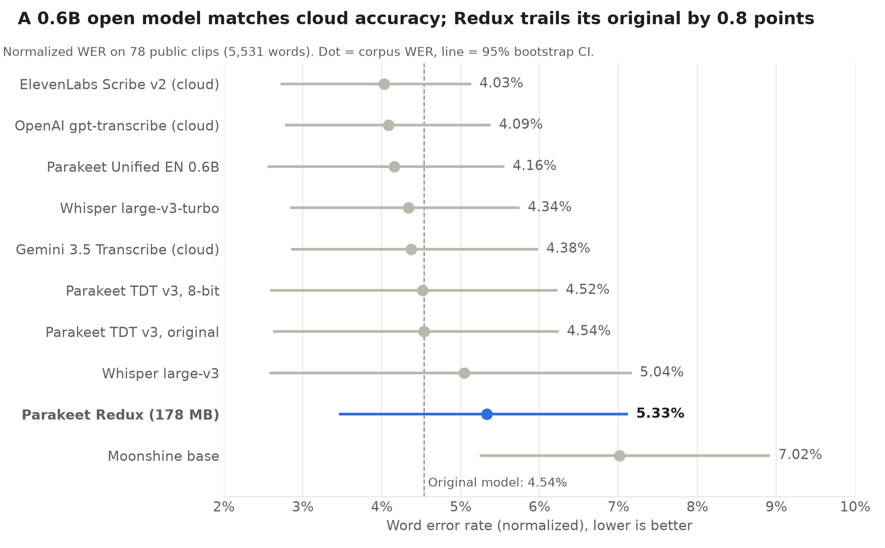
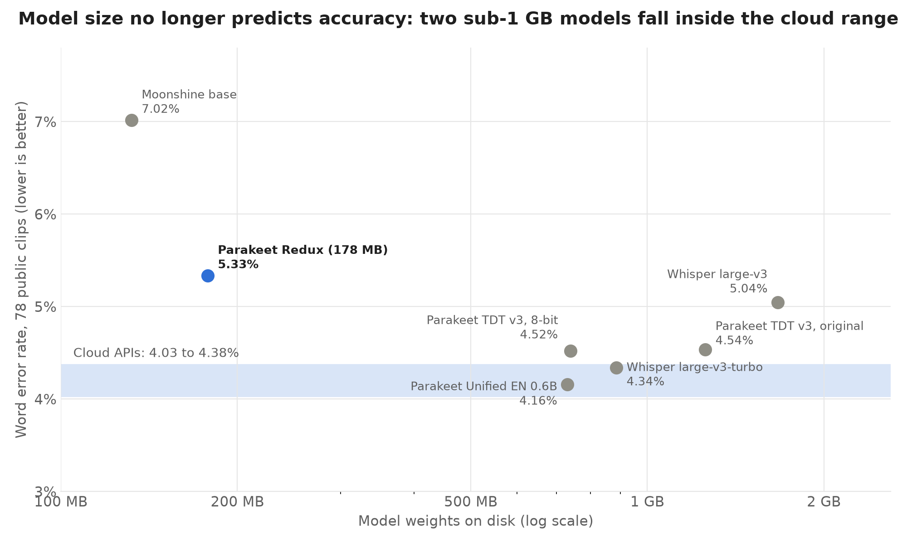
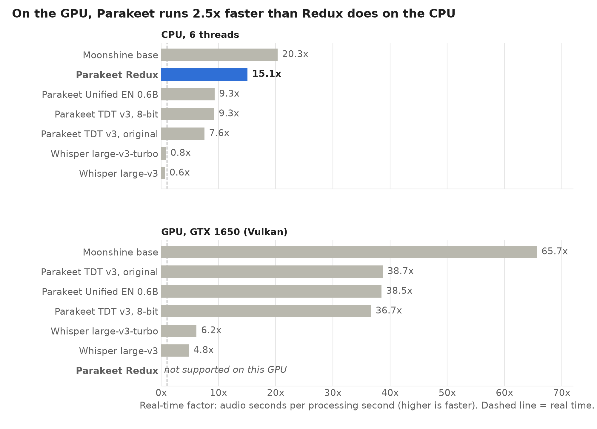

# How Small Can Speech Recognition Get? A Controlled Benchmark of 10 Speech-to-Text Systems

*Parakeet Redux, its original model, Whisper, Moonshine and three cloud APIs, measured on one mid-range laptop*

October 2026 · Abhash Chakraborty

> **Kaggle completion update (6 October 2026):** This file preserves the original laptop report. Read [the final Redux-focused Kaggle supplement](report_kaggle.md) for the two-session T4 comparison and real-world verdict. It also corrects interpretations below: interval overlap does not prove equivalence, 8-bit conversion showed no measurable loss in this sample, and the dictation reference was model-consensus-adjusted rather than independently human-verified.

---

## TL;DR

- **Model size no longer predicts accuracy.** Two open models of 0.6–0.8 B parameters (731–886 MB on disk) score 4.16% and 4.34% word error rate (WER), inside the range of three commercial cloud APIs (4.03–4.38%). Whisper large-v3, at 1.55 B parameters and the largest model tested, scores 5.04%.
- **Ordinary 8-bit quantization is free.** Parakeet TDT 0.6B v3 loses nothing going from 16-bit (1,256 MB) to 8-bit (740 MB): 4.54% vs 4.52% WER, statistically identical.
- **Extreme (ternary) compression works, with a cost that isn't uniform.** Parakeet Redux is 7x smaller than its original (178 MB) and 2x faster on a CPU. It averages 0.8 WER points more errors (5.33% vs 4.54%). The gap almost vanishes on clean benchmark audio (+0.2 points) but grows to +1.5 to +2.2 points on accented speech.
- **Local inference is fast on modest hardware.** On a 2019-era 4 GB GPU, the best open models transcribe 38x faster than real time (one hour of audio in about 1.5 minutes, 0.2 s per spoken sentence). On the CPU alone, Redux reaches 15x real time.
- **Packaging decides practicality as much as the model does.** Redux could not run natively on the Windows test machine (missing CPU kernel) and Whisper is slower than real time on its CPU. The runtime and kernels matter as much as the weights.
- **Cloud APIs keep an edge in features, not English accuracy.** They cost $0.22–0.37 per audio hour and send audio to a third party. Their remaining advantages are punctuation quality (OpenAI), languages and extra features, not lower word error on English.

---

## 1. Why this experiment

Speech recognition used to require either a large model or a cloud API. Three trends challenge that:

1. Compact architectures (NVIDIA's FastConformer-based Parakeet family) now rival much larger models.
2. Weight compression has moved from 8-bit to ternary weights (each weight is -1, 0 or +1). [Parakeet Redux](https://huggingface.co/moondream/parakeet-redux) (Moondream, 2026) applies this to Parakeet TDT 0.6B v3 and claims near-original accuracy at 178 MB.
3. Local runtimes (ggml / transcribe-cpp, Photon) run these models on ordinary CPUs and consumer GPUs.

This benchmark asks, under controlled conditions, how far that has come:

1. How accurate is a 178 MB ternary model compared with the model it was compressed from?
2. How do small open models compare with a large open model (Whisper large-v3) and with commercial cloud APIs?
3. How fast are they, on a CPU and on a modest GPU, and what memory do they need?
4. What do cloud APIs cost, and what privacy trade-off do they carry?
5. Where, given all this, does each class of model make sense?

## 2. What was tested

Ten systems were tested. All seven open-weights configurations ran locally on the same laptop. The three proprietary models were called through their APIs.

| System | Type | Parameters | Weights on disk | Runtime used | Licence |
| --- | --- | --- | --- | --- | --- |
| [Parakeet Redux](https://huggingface.co/moondream/parakeet-redux) | open, ternary | 0.6B architecture | 178 MB | Photon (moondream 2.6.1), Linux container, CPU | CC-BY-4.0 |
| [Parakeet TDT 0.6B v3](https://huggingface.co/nvidia/parakeet-tdt-0.6b-v3), original | open | 0.6B | 1,256 MB (F16) | transcribe-cpp 0.3.1 | CC-BY-4.0 |
| Parakeet TDT 0.6B v3, 8-bit | open | 0.6B | 740 MB (Q8_0) | transcribe-cpp | CC-BY-4.0 |
| [Parakeet Unified EN 0.6B](https://huggingface.co/nvidia/parakeet-unified-en-0.6b) | open, English-only, streaming-capable | 0.6B | 731 MB (Q8_0) | transcribe-cpp | NVIDIA Open Model Licence |
| Whisper large-v3 | open | 1.55B | 1,669 MB (Q8_0) | transcribe-cpp | MIT |
| Whisper large-v3-turbo | open | 0.8B | 886 MB (Q8_0) | transcribe-cpp | MIT |
| Moonshine base | open, edge-oriented | 61M | 132 MB (F16) | transcribe-cpp | MIT |
| OpenAI `gpt-transcribe` | cloud | n/a | n/a | API | commercial |
| ElevenLabs `scribe_v2` | cloud | n/a | n/a | API | commercial |
| Google `gemini-3.5-transcribe` | cloud | n/a | n/a | API via Vercel AI Gateway | commercial |

The two Parakeet TDT rows are Redux's parent model at original precision and at standard 8-bit. Together with Redux they isolate the effect of compression on one fixed architecture. All GGUF conversions come from [handy-computer](https://huggingface.co/handy-computer), so every open model except Redux ran in the same engine. Redux is only available for Moondream's Photon engine.

## 3. How it was tested

The method was written down before any result was collected (`docs/PROTOCOL.md`), and every later decision is timestamped in a lab notebook (`docs/LOG.md`).

**Machine.** AMD Ryzen 5 5600H (6 cores / 12 threads, AVX2, no AVX-512 or AVX-VNNI), 15.3 GB RAM, NVIDIA GTX 1650 4 GB (used through Vulkan), Windows 11.

**Data.** About 36 minutes of English audio in five subsets, every one with a human-written reference:

| Subset | Content | Clips | Audio | Reference |
| --- | --- | --- | --- | --- |
| A: real-world | 6 YouTube clips: TED (CRISPR), podcast interview, MIT lecture, PBS NewsHour, TEDx talk by an Indian-English speaker, street interviews | 6 | 20.7 min | Human-made caption tracks (auto-captions excluded) |
| B: benchmark | 10 utterances each from LibriSpeech test-clean, test-other, Earnings-22, AMI, VoxPopuli; 4–25 s; random seed 42 | 50 | 6.3 min | Dataset transcripts ([Open ASR Leaderboard sets](https://huggingface.co/datasets/hf-audio/esb-datasets-test-only-sorted)) |
| B2: accents | Speech Accent Archive (Kaggle): 12 speakers of 12 first languages, incl. Hindi, Bengali, Tamil, plus a US English control | 12 | 4.9 min | The fixed reading passage |
| C: noise | The 10 test-clean clips with pink noise at 5 dB SNR | 10 | 1.2 min | Same as B |
| D: dictation | One speaker dictating 4 paragraphs (email, technical note, numbers and places, casual) into a laptop microphone | 4 | 2.2 min | The script, plus a verbatim version (see 5.4) |

**Fairness controls.**

- Every system received byte-identical audio. Clips over 30 s were cut once, at speech pauses, into 7–28 s chunks used by all systems.
- Every CPU run was pinned to 6 threads.
- Each configuration ran in a fresh process, in randomized order, with a 60 s cool-down between configurations.
- Background applications were closed and the machine ran on AC power.

**Metrics.**

- **Accuracy:** word error rate after the Whisper English text normalizer (the Open ASR Leaderboard convention), with 95% bootstrap confidence intervals over clips. Compression effects are tested with a paired bootstrap on identical clips.
- **Speed:** real-time factor (RTFx) = audio seconds per processing second, the median of 3 timed passes after a warm-up. Also per-clip latency (p50 / p95), cold start, peak RAM and GPU memory, sampled every 50 ms.
- **Determinism:** a 10-clip CPU rerun produced word-for-word the same text as the GPU run for every local model, so accuracy does not depend on the device.

## 4. Results: accuracy

*Normalized WER on the 78 public clips (subsets A, B, B2, C; 5,531 reference words). Source: `results/metrics_accuracy.csv`.*

Five systems sit within 0.35 points of each other at the top: three cloud APIs and two open models. Their confidence intervals overlap almost completely, so on this test they are statistically tied. The larger Whisper large-v3 does not improve on its smaller turbo variant, and the 61M-parameter Moonshine is clearly behind at 7.02%.

| System | Real-world (A) | Benchmarks (B) | Accents (B2) | Noise 5 dB (C) | Punctuated WER* |
| --- | --- | --- | --- | --- | --- |
| ElevenLabs Scribe v2 | 4.84% | 3.99% | 1.81% | 0.73% | 16.0% |
| OpenAI gpt-transcribe | 4.35% | 5.12% | 2.42% | 2.18% | 12.2% |
| Parakeet Unified EN 0.6B | 5.01% | 3.99% | 1.81% | 1.09% | 14.1% |
| Whisper large-v3-turbo | 4.72% | 6.24% | 1.33% | 1.82% | 12.3% |
| Gemini 3.5 Transcribe | 4.96% | 5.53% | 1.93% | 0.36% | 13.0% |
| Parakeet TDT v3, 8-bit | 5.48% | 4.20% | 2.17% | 0.73% | 13.3% |
| Parakeet TDT v3, original | 5.51% | 4.20% | 2.17% | 0.73% | 13.3% |
| Whisper large-v3 | 6.46% | 4.50% | 0.85% | 1.82% | 13.9% |
| Parakeet Redux | 6.29% | 4.40% | 3.62% | 1.82% | 14.5% |
| Moonshine base | 6.95% | 9.01% | 5.31% | 5.82% | 16.1% |

\*Punctuated WER keeps punctuation as separate tokens. It is scored only on subsets with punctuated references (A, B2) and reflects how clean the output text looks. It is high for every system because human captions punctuate inconsistently; compare systems against each other, not against zero.

**Accuracy against size.** The relationship between model size and accuracy is weak in this set:

*Weights on disk (log scale) against WER on the 78 public clips. The band is the range of the three cloud APIs.*

## 5. Results: speed, latency and resources

*Median of 3 timed passes over a 20-clip, 4.1-minute speed subset; run-to-run spread under 1%. Source: `results/metrics_speed.csv`.*

Time to transcribe one hour of audio, derived from the measured real-time factors:

| System | GPU (GTX 1650) | CPU (6 threads) |
| --- | --- | --- |
| Moonshine base | 55 s | 3.0 min |
| Parakeet TDT original / 8-bit / Unified | 1.6 min | 6.4–7.9 min |
| Parakeet Redux | not supported | 4.0 min |
| Whisper large-v3-turbo | 9.7 min | 74 min |
| Whisper large-v3 | 12.5 min | 93 min |

Per-clip latency is the dictation case: one 4–25 s clip at a time, with the model already loaded.

| Configuration | Latency p50 / p95 | Cold start | Peak RAM | GPU memory |
| --- | --- | --- | --- | --- |
| Parakeet Unified EN 0.6B, GPU | 0.20 / 0.38 s | 2.1 s | 225 MB | 772 MB |
| Parakeet TDT original, GPU | 0.21 / 0.34 s | 3.0 s | 228 MB | 1,271 MB |
| Moonshine base, GPU | 0.10 / 0.24 s | 1.5 s | 154 MB | 181 MB |
| Whisper large-v3-turbo, GPU | 1.45 / 1.52 s | 3.6 s | 275 MB | 956 MB |
| Whisper large-v3, GPU | 1.81 / 2.11 s | 5.1 s | 258 MB | 1,973 MB |
| Parakeet Redux, CPU | 0.48 / 1.03 s | 9.4 s | 982 MB | none |
| Parakeet Unified EN 0.6B, CPU | 0.81 / 1.73 s | 2.7 s | 1,188 MB | none |
| Parakeet TDT original, CPU | 1.00 / 2.12 s | 3.7 s | 1,724 MB | none |
| Moonshine base, CPU | 0.30 / 0.90 s | 1.4 s | 266 MB | none |
| Whisper large-v3, CPU | 13.75 / 15.30 s | 16.6 s | 2,062 MB | none |
| OpenAI gpt-transcribe (cloud) | 1.05 / 1.39 s | none | none | none |
| ElevenLabs Scribe v2 (cloud) | 1.03 / 1.68 s | none | none | none |
| Gemini 3.5 Transcribe (cloud) | 3.03 / 3.68 s | none | none | none |

Cloud latency is the full round trip from the test machine's internet connection, including upload. It depends on network and region. Cloud throughput can be raised by sending requests in parallel, so the cloud rows are not comparable on throughput, only on per-request latency.

Observations:

- **Whisper's latency does not shrink with clip length.** It always processes a 30-second window, so a 5-second sentence costs as much as a 30-second one: 11–14 s on this CPU.
- **Small weights don't guarantee small memory.** Redux's 178 MB of weights runs in about 980 MB of RAM, only ~20% less than the 8-bit Parakeet, because its PyTorch-based runtime dominates the footprint. Its cold start is also the slowest of the fast models (8–9 s).
- **Thread scaling.** Redux ran at 14.6x on 4 threads (its default), 15.1x on 6, and 13.3x on 12. Hyper-threads hurt.
- **First GPU use** on a fresh install adds 4–8 s once, for shader compilation; later cold starts are 2–5 s.

## 6. Results: robustness

**Accents (12 speakers of different first languages, one fixed passage).** Most strong systems stay at 1–2.5% WER. Redux (3.62%) is the clear outlier among them, 1.45 points worse than its own original (2.17%). With 12 speakers this is directional, but it matches the dictation result below.

**Noise (pink noise at 5 dB SNR on clean speech).** Every system except Moonshine stays below 2.2% WER, and the Parakeet models lose almost nothing. Moderate stationary noise is no longer a differentiator; real-world noise (street interviews in subset A) is harder for all of them (6.8–12.4% on that clip).

**Single-speaker dictation (4 paragraphs, 225 words).** The speaker departed from the script in places, so each system was scored two ways: against the script, and against a verbatim reference of what was actually said. The verbatim reference counts a change as spoken only where at least 5 of the 6 strong local models agreed on the same everyday-word change. Names (Ananya, Parakeet) keep the script spelling, since recognizing them is part of the test. Time formats such as 3.30 vs 3:30 count as equal.

| System | WER vs what was said | WER vs the script |
| --- | --- | --- |
| Whisper large-v3 | 1.3% | 7.9% |
| ElevenLabs Scribe v2 | 2.2% | 8.8% |
| Parakeet Unified EN 0.6B | 2.7% | 9.3% |
| Gemini 3.5 Transcribe | 2.7% | 8.4% |
| Parakeet TDT v3, 8-bit | 2.7% | 9.3% |
| OpenAI gpt-transcribe | 3.1% | 8.8% |
| Parakeet TDT v3, original | 3.1% | 9.7% |
| Whisper large-v3-turbo | 3.1% | 9.7% |
| Parakeet Redux | 4.9% | 11.5% |
| Moonshine base | 5.8% | 12.3% |

At 225 words, one error is 0.44 points, so differences under about 1.5 points are ties. Redux's extra errors were phonetic ("flight **lines**" for "lands", "revenue **grow**" for "grew"). Every system misheard the name "Ananya", so rare proper nouns remain a weakness across the board.

## 7. Case study: what ternary compression costs

| | Parakeet Redux | Original, 8-bit | Original, F16 |
| --- | --- | --- | --- |
| Weights on disk | 178 MB | 740 MB | 1,256 MB |
| WER, 78 public clips | 5.33% | 4.52% | 4.54% |
| WER, clean benchmark utterances (B) | 4.40% | 4.20% | 4.20% |
| WER, accents (B2) | 3.62% | 2.17% | 2.17% |
| WER, dictation (verbatim) | 4.89% | 2.67% | 3.11% |
| CPU speed, 6 threads | 15.1x | 9.3x (10.7x in the same container) | 7.6x |
| Peak RAM on CPU | 982 MB | 1,232 MB | 1,724 MB |
| Runs on the test GPU | No | Yes, 36.7x | Yes, 38.7x |
| Runs natively on the test OS (Windows) | No | Yes | Yes |

Paired bootstrap on the same 78 clips (10,000 resamples):

| Comparison | WER difference | 95% CI | Resamples where the first is worse |
| --- | --- | --- | --- |
| Redux minus original F16 | +0.80 points | -0.10 to +1.54 | 96% |
| Redux minus original 8-bit | +0.81 points | -0.14 to +1.60 | 96% |
| Original 8-bit minus F16 | -0.02 points | -0.07 to +0.05 | 19% |
| Redux minus Parakeet Unified EN | +1.18 points | +0.23 to +2.08 | 99% |

- **Pre-registered test.** Before the runs, "no meaningful loss" was defined as an upper bound below +0.5 points. The bound reached +1.54, so that claim is not supported. The loss is also not significant at the strict 95% level on 78 clips: 96% of resamples point the same way, so it is likely real but modest.
- **The model card is consistent with this.** It reports 6.55% average WER on 7 Open ASR Leaderboard sets and no accent breakdown. On clean benchmark audio our gap is only +0.2 points, so leaderboard-style averages understate the cost on accented speech.
- **Two compression steps behave differently.** 16-bit to 8-bit removes 41% of the size at no measurable cost. 8-bit to ternary removes another 76% and buys roughly 1.4–2x CPU speed, at a measurable but modest accuracy cost.

## 8. Cost and privacy

| System | Price per audio hour | Where audio goes | Retained by default | Zero-retention option |
| --- | --- | --- | --- | --- |
| Open models, run locally | $0 (own hardware and electricity, not measured) | Stays on the device; works offline | No | Not needed |
| [OpenAI `gpt-transcribe`](https://developers.openai.com/api/docs/models/gpt-transcribe) | $0.27 ($0.0045/min) | OpenAI | [Not stored for abuse monitoring on the transcription endpoint; not used for training by default](https://developers.openai.com/api/docs/guides/your-data) | Yes, for approved customers |
| [ElevenLabs Scribe v2](https://elevenlabs.io/pricing/api) | $0.22 | ElevenLabs | [Yes, per privacy policy; history on by default](https://elevenlabs.io/docs/eleven-api/resources/zero-retention-mode) | Enterprise only |
| [Gemini 3.5 Transcribe via Vercel](https://vercel.com/ai-gateway/models/gemini-3.5-transcribe) | ~$0.37 (estimate*) | Vercel gateway, then Google | [Gateway keeps nothing; upstream depends on routing](https://vercel.com/docs/ai-gateway/capabilities/zdr) | Opt-in, paid plans |

\*Billed per token ($2 per 1M input, $12 per 1M output). The estimate assumes 32 audio tokens per second and about 12,000 output tokens per hour of speech.

At these prices, 1,000 hours of audio cost $220–370 in the cloud. Locally, the same volume takes about 26 GPU-hours on a GTX 1650 with Parakeet, or 66 CPU-hours with Redux.

## 9. Interpretation: what the results mean

**1. Architecture and training now matter more than parameter count.** The most accurate open models here have 0.6–0.8 B parameters. The largest, Whisper large-v3 at 1.55 B, is no better than its smaller turbo variant (0.8 B) and worse than Parakeet Unified on most subsets. For English transcription, scaling past about 0.6 B no longer buys accuracy on its own.

**2. The open/cloud accuracy gap has closed for English.** On public data and on live dictation, the best open models are statistically tied with three commercial APIs. The clouds still differ in output style: OpenAI produced the cleanest punctuation. They also offer features this test did not measure (many languages, diarization, word-level timestamps, custom vocabulary).

**3. Compression has two regimes.** 8-bit quantization is effectively free and should be the default for local deployment. Ternary weights are the new frontier: a 0.6 B model in 178 MB, close to a 61M-parameter model's footprint, with far better accuracy than that small model (5.33% vs 7.02%). But the cost concentrates on harder inputs such as accents, which averages hide. Anyone shipping ternary models should evaluate on their own speakers, not leaderboard averages.

**4. The deployment stack is now the bottleneck.** The practical ranking on this machine was decided as much by software as by weights:
- Redux had no Windows kernel for this CPU and no support for this GPU.
- Whisper's fixed 30-second window makes it slow for short utterances on any hardware.
- Redux's runtime erased much of its memory advantage.

Better kernels and packaging, not better models, are the next unlock for small models.

**5. Mid-range consumer hardware is enough.** A 4 GB, 2019-era GPU runs cloud-grade English recognition at 38x real time with 0.2 s latency. That removes cost and privacy as the main reasons to call an API for English speech.

## 10. Where things stand (as of October 2026)

| Dimension | State | Evidence in this test |
| --- | --- | --- |
| English accuracy, open vs cloud | Parity | 4.16% vs 4.03–4.38% WER; overlapping CIs |
| Accuracy per megabyte | Rapidly improving | 178 MB ternary model within 0.8 points of its 1.26 GB original |
| CPU-only real-time transcription | Solved for 0.6 B-class models | 7.6–15x real time on a 6-core laptop CPU |
| Low-latency dictation on consumer GPUs | Solved | 0.2 s per sentence on a GTX 1650 |
| Robustness to accents | Uneven, worst under extreme compression | Redux +1.45 to +2.2 points on accented speech |
| Rare names and proper nouns | Unsolved for all systems | Every system misheard "Ananya" |
| Cross-platform packaging of new runtimes | Immature | Redux: no Windows AVX2 kernel; GPU path needs Ampere or newer |

## 11. When and where each class fits

| Scenario | Fits best | Why | Watch out for |
| --- | --- | --- | --- |
| Real-time dictation on a PC with a GPU | 0.6 B Parakeet-class models (8-bit) | Cloud-level accuracy, 0.2 s latency, offline | Needs ~0.8 GB of GPU memory |
| Dictation on CPU-only laptops | 8-bit Parakeet; Redux where its runtime is supported | 0.5–0.8 s per sentence | Redux needs Linux/macOS or a supported CPU; less robust to accents |
| Edge, embedded, low-memory devices | Moonshine (132 MB); Redux (178 MB) if accuracy matters | Smallest footprints | Moonshine ~7% WER; Redux needs ~1 GB RAM in its current runtime |
| Bulk transcription of archives | Parakeet on a GPU | 1 hour in ~1.6 min, no per-hour cost | One-time hardware cost |
| Privacy-sensitive audio (health, legal, internal meetings) | Any local model | Audio never leaves the device | Cloud zero-retention options are enterprise or approval-gated |
| Many languages, diarization, managed service | Cloud APIs, or multilingual open models (Whisper, Parakeet TDT v3) | Broader features; nothing to operate | $0.22–0.37 per audio hour; data leaves the device; not tested here beyond English |
| Long-form, clean, offline batch where speed is irrelevant | Whisper large-v3 | Clean, filler-free output style | 6–8x slower than Parakeet on GPU; slower than real time on CPU |
| Heavily accented speakers | Systems with the best B2 and dictation results (Whisper, ElevenLabs, Parakeet Unified) | Lowest accent error here | Avoid extreme-compressed models without testing on your speakers |

## 12. Limitations and threats to validity

- **Sample size.** 78 public clips (36 min) and 225 dictated words. Differences under about 1 point overall, or 1.5 points on the dictation set, are not reliable.
- **English only.** Several systems are multilingual; that was not tested.
- **One machine.** CPUs with AVX-VNNI or AVX-512, Apple Silicon and Ampere-class GPUs would change the speed picture, especially for Redux, whose fast paths were unavailable here.
- **Runtime choice.** Open models other than Redux ran in transcribe-cpp. NeMo, faster-whisper or CUDA backends could change speed and, slightly, output. Only the Parakeet Unified conversion's publisher reports validation against NVIDIA's reference implementation.
- **Reference style.** Caption tracks are partly verbatim and partly edited. Whisper writes clean, filler-free text, which verbatim references count as deletions.
- **Cloud models change without notice.** Results are for `gpt-transcribe`, `scribe_v2` and `gemini-3.5-transcribe` as of 2026-10-05, under default account terms. Cloud latency depends on the network.
- **Deviations from the protocol, all logged:**
  - Redux ran in a Linux container. The same 8-bit Parakeet model ran 16% *faster* there than natively, so this does not disadvantage Redux.
  - YouTube audio was peak-normalized and all systems were rerun after inputs were found to exceed full scale.
  - The speed subset was reduced to 20 clips before any timed run.
  - The dictation set was changed to 4 paragraphs before recording.

## 13. Future scope

1. **Hardware breadth:** repeat the speed runs on an AVX-VNNI/AVX-512 x86 CPU, Apple Silicon, an Ampere-or-newer GPU and an ARM board, where Redux's fast kernels apply.
2. **Streaming latency:** Parakeet Unified supports streaming down to 160 ms chunks; measure time-to-first-word, not just per-utterance latency.
3. **Multilingual evaluation:** FLEURS or Common Voice subsets for Parakeet TDT v3, Whisper and the cloud APIs.
4. **Accent robustness at scale:** 100+ speakers, to test whether ternary compression's accent penalty holds and where it concentrates.
5. **Energy:** watts per audio hour, local vs cloud, for battery-powered devices.
6. **Other compressions:** 4-bit (Q4_K_M) GGUFs, which sit between 8-bit and ternary in size, and ternary versions of other architectures if they appear.
7. **Vocabulary biasing:** test custom-vocabulary and prompt features for proper nouns, the one weakness shared by every system.
8. **Native Windows support:** rerun Redux when Photon ships a Windows AVX2 kernel.

## 14. Reproducibility and data availability

Everything needed to rerun or audit the experiment is in this repository.

| File | Contents |
| --- | --- |
| `README.md` | Overview and the exact commands, in order |
| `docs/PROTOCOL.md` | Pre-registered method |
| `docs/LOG.md` | Lab notebook: every decision, failure and deviation, timestamped |
| `data/units.csv`, `data/manifest_*.csv` | The 147 audio units every system received; source, licence and reference of every clip |
| `results/raw/<system>/` | Every transcript, timing and resource log |
| `results/metrics_accuracy.csv`, `metrics_speed.csv`, `paired.csv`, `per_clip.csv` | Scored results |
| `results/env.json` | Package versions, GPU driver, SHA-256 of every model file |
| `results/figures/` | The charts, regenerated by `scripts/make_figures.py` |
| `docker/Dockerfile.photon` | The Linux runtime used for Redux |

Audio is not redistributed (source licences; a private recording). The scripts rebuild the public subsets from the sources in the manifests. Key versions: transcribe-cpp 0.3.1, moondream 2.6.1 (kestrel-kernels 0.7.4), jiwer 4.0.0, whisper-normalizer 0.1.15, NVIDIA driver 610.88.
